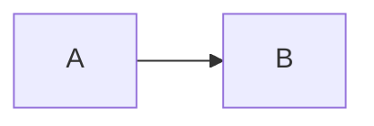

# Presentations with presenterm

presenterm shows a markdown file as slides in the terminal. This skill gives the syntax for presenterm 0.16. Run `presenterm --version` first. If the major or minor version is not 0.16, run `presenterm --list-comment-commands` and compare with the commands below.

## Rules that break a deck

1. A slide title is a setext heading: the title text, then `===` on the next line. A `#` heading is a styled heading, not a slide title.
2. Slides end with `<!-- end_slide -->`. The front matter below turns on two shorter forms.
3. A mermaid, LaTeX or Typst block renders only with `+render` after the language. Without it, the slide shows the source code.
4. Image paths are relative to the presentation file. Remote images do not work.
5. Do not put `+exec` or `+exec_replace` on a snippet unless the user asks for it. presenterm runs that code on the machine of the presenter.

## Start from this template

````markdown
---
title: "Deck title, markdown is allowed"
sub_title: Optional subtitle
author: Spyros Goulas
theme:
  name: tokyonight-storm
options:
  implicit_slide_ends: true
  end_slide_shorthand: true
---

First slide
===

- A point
<!-- pause -->
- A point that shows after a key press

Second slide
===

Text of the second slide.
````

The front matter creates the intro slide from `title`, `sub_title` and `author`. For two or more authors, use `authors:` with a YAML list in place of `author`.

With `implicit_slide_ends: true`, each setext title starts a new slide. With `end_slide_shorthand: true`, a `---` line also ends a slide. Without these options, put `<!-- end_slide -->` between slides.

Built-in themes: `dark`, `light`, `terminal-dark`, `terminal-light`, `gruvbox-dark`, `catppuccin-latte`, `catppuccin-frappe`, `catppuccin-macchiato`, `catppuccin-mocha`, `tokyonight-storm`, `tokyonight-moon`, `tokyonight-night`, `tokyonight-day`. The user's Neovim theme is `tokyonight-storm`, so use it unless the user asks for a different one.

## Comment commands

| Command | Effect |
|---|---|
| `<!-- pause -->` | Shows the rest of the slide after a key press |
| `<!-- end_slide -->` | Ends the slide |
| `<!-- new_lines: 2 -->` | Adds empty lines |
| `<!-- jump_to_middle -->` | Moves the next content to the vertical middle, for a title-only slide |
| `<!-- column_layout: [3, 2] -->` | Splits the slide into columns with relative widths |
| `<!-- column: 0 -->` | Puts the next content in column 0 |
| `<!-- reset_layout -->` | Goes back to full width |
| `<!-- incremental_lists: true -->` | Shows list items one at a time |
| `<!-- alignment: center -->` | Aligns the text (`left`, `center`, `right`) |
| `<!-- font_size: 2 -->` | Makes the text larger (1 to 7, kitty protocol only) |
| `<!-- no_footer -->` | Hides the footer on this slide |
| `<!-- skip_slide -->` | Leaves the slide out of the presentation |
| `<!-- include: other.md -->` | Inserts another markdown file |
| `<!-- speaker_note: text -->` | Adds a note for the speaker view |
| `<!-- // text -->` | A comment that does not show |

To center content horizontally, use `<!-- column_layout: [1, 3, 1] -->` and put the content in column 1.

## Code blocks

| Fence line | Effect |
|---|---|
| ` ```rust +line_numbers ` | Shows line numbers |
| ` ```rust {1,3,5-7} ` | Highlights these lines |
| ` ```rust {1-4\|6-10\|all} ` | Highlights each group in turn, one per key press |
| ` ```bash +exec ` | The presenter runs it with `ctrl+e` (needs `-x`) |
| ` ```bash +exec +id:out ` | Runs it, and `<!-- snippet_output: out -->` shows the output in another place |
| ` ```rust +no_background ` | Removes the block background |

You can combine attributes, for example ` ```rust {1-4|all} +line_numbers `. To run a line but not show it, start the line with `# ` in Rust or with `/// ` in Python, Bash, JavaScript, TypeScript, Java, Kotlin, Go and C.

## Diagrams, math and images

````markdown


```latex +render
\[ e^{i\pi} + 1 = 0 \]
```


````

- **Mermaid** needs `mmdc`. Each diagram takes about two seconds to render.
- **LaTeX** needs `typst` and `pandoc`. A ` ```typst +render ` block needs only `typst`.
- **Images** keep their aspect ratio and shrink to fit the terminal.

Before you use a LaTeX or Typst block, run `command -v typst pandoc`. If a tool is missing, tell the user. Do not install it without approval.

## Check the deck

presenterm needs an interactive terminal, so you cannot run or export the deck from the Bash tool. A run without a terminal fails or hangs. Do these steps after you write the file:

1. Read the file back and check each slide against the rules at the top.
2. Tell the user to open it in a terminal with `presenterm <file>.md`. Add `-x` only if the deck has `+exec` blocks.
3. Tell the user that `presenterm --validate-overflows <file>.md` finds text that does not fit on the screen.

If the user wants a file to share, give the export commands:

- **HTML:** `presenterm --export-html <file>.md` writes one self-contained HTML file with the images included.
- **PDF:** `uv run --with weasyprint presenterm --export-pdf <file>.md` works if `uv` is installed. Without `uv`, the user must install `weasyprint` first.
